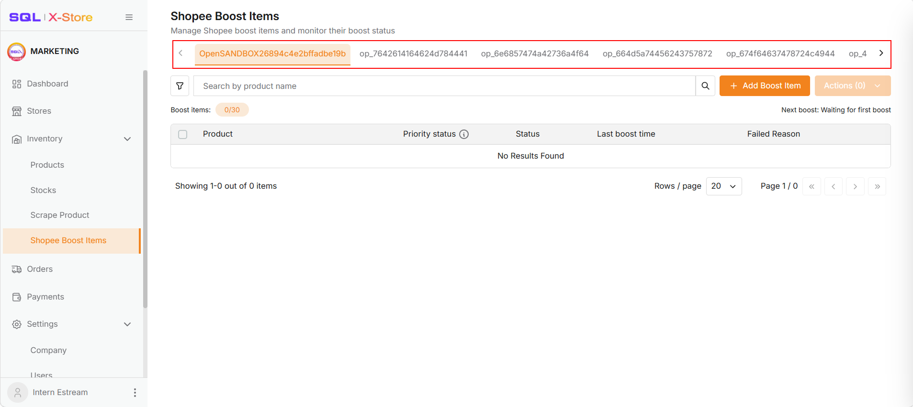
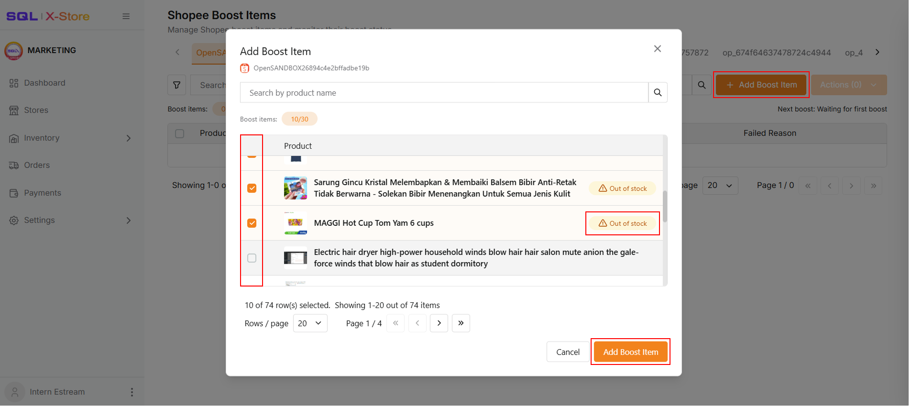
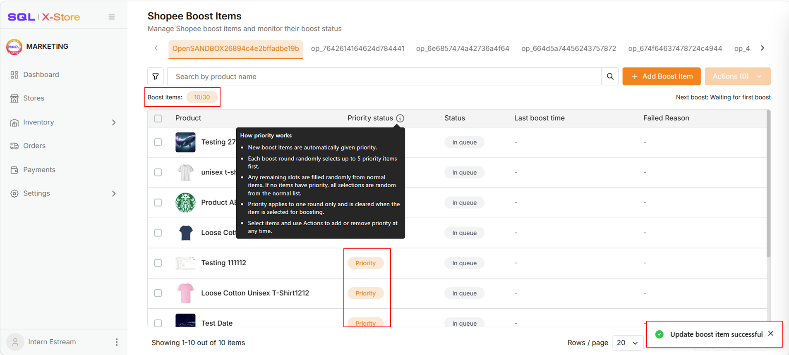
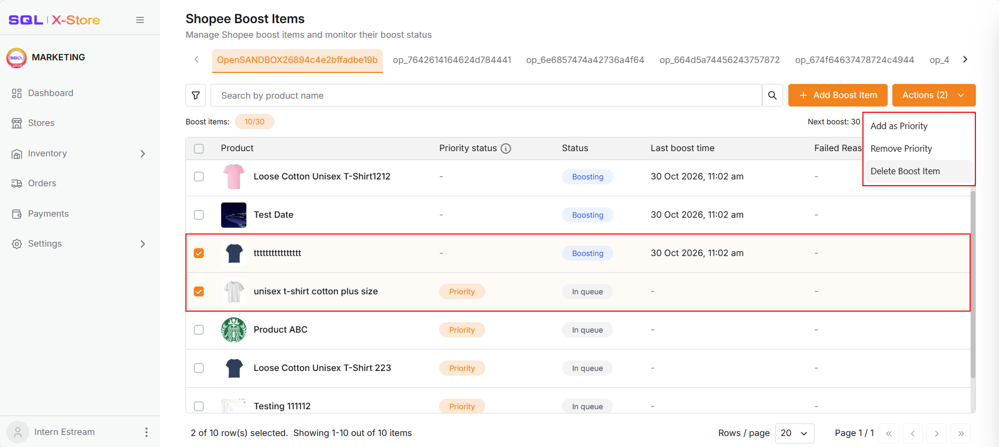
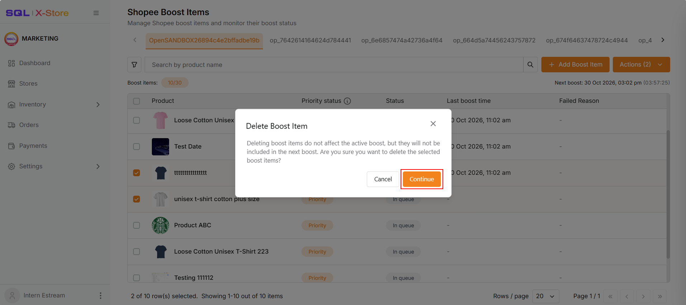
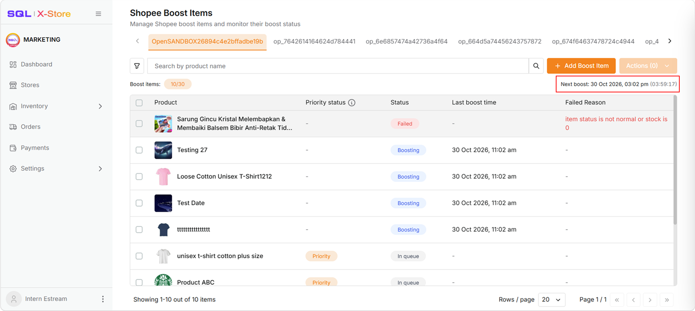
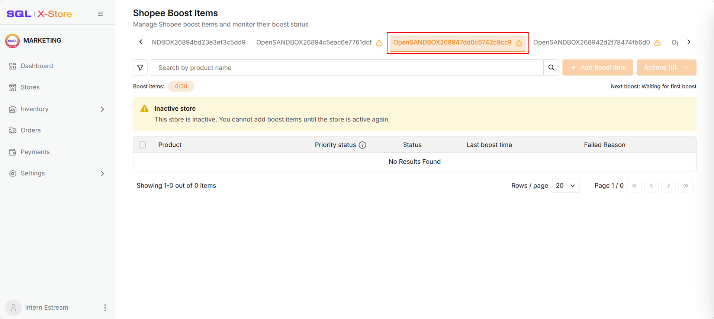

The **Shopee Boost Items** page lets you manage boost items and track boost progress for each Shopee store. Every four hours, 5 random items from the boost list are boosted automatically.

## Manage Boost Items

### Add Boost Items

:::warning
Items with an **Out of stock** badge can still be added, but the boost may fail. Restock and update the item first.
:::

To boost the sales of specific items, add them to the boost list.

1. Select the store tab.
2. Click **Add Boost Item**.
3. Select the items you want to add. You can add up to **30** items per store.
4. Click **Add Boost Item** to confirm, or **Cancel** to exit without changes.

### View Boost List

:::info

- New boost items are automatically given priority.
- Each boost round randomly selects up to 5 priority items first.
- Any remaining slots are filled randomly from normal items. If no items have priority, all selections are random.
- Priority applies to one round only and is cleared once the item is selected for boosting.

:::

Added items appear in the table. The current boost item count (for example, `10/30`) is shown above the table.

### Prioritize Boost Items

You can add or remove priority at any time.

1. Select one or more items.
2. Click the **Actions** dropdown.
3. Choose **Add as Priority** or **Remove Priority**.

### Delete Boost Items

:::info
Deleting boost items does not affect the active boost. They will just not be included in the next boost.
:::

Delete items you no longer want to boost.

1. Select one or more items.
2. Click the **Actions** dropdown.
3. Click **Delete Boost Item**.
4. Click **Continue** to confirm, or **Cancel** to exit without changes.

## Track Boost Progress

- The **next boost time** and a countdown timer are shown at the top right of the table.
- In the table, the **Status** column shows **Boosting** for items boosted in the latest round and **In queue** for items waiting for the next boost.
- Items that fail to boost show **Failed** with the reason in the **Failed Reason** column.
- The **Last boost time** column shows when each item was last boosted.

## Inactive Store

An inactive store is marked with a ⚠ warning icon on its tab. You cannot add boost items to an inactive store until it becomes active again, because the boost would fail even if the items were added.

