## Overview

The **Stocks** module allows you to view and manage stock items synced from SQL Account.

:::info
For more information regarding **Sync Stock Item**, please refer to **[Setup](../setup.md#step-5-sync-stock-items-from-sql-account)**
:::

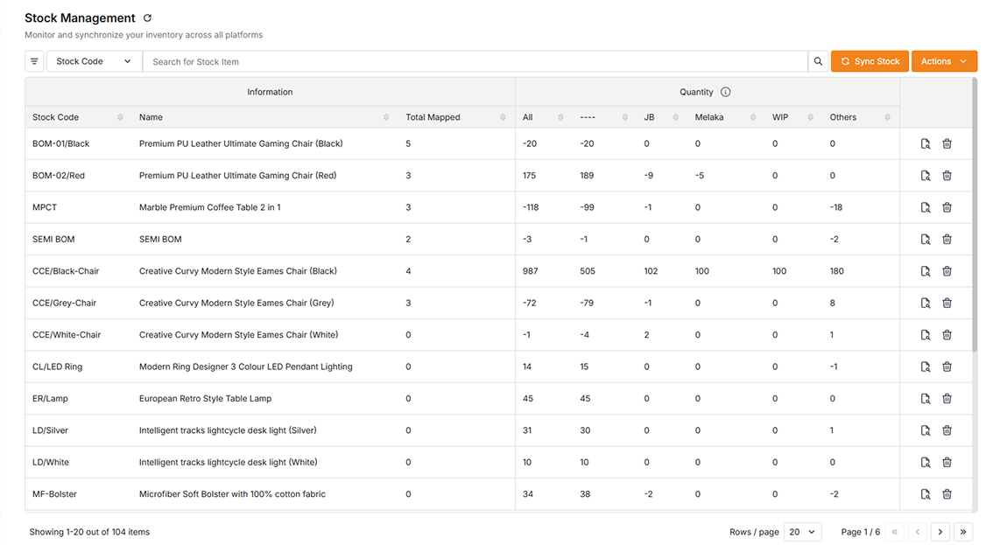

## Map Products

Mapping platform products to stock items allows you to manage stock and quantity using the main stock item, improving stock quantity accuracy. There are two ways to map products:

### Map Multiple Stock Items

1. Go to **Inventory > Stocks**

2. Click the **Map Product** button under the **Actions** button

   

3. Select the **Platform Products** and then a **Stock Item** to map them together

   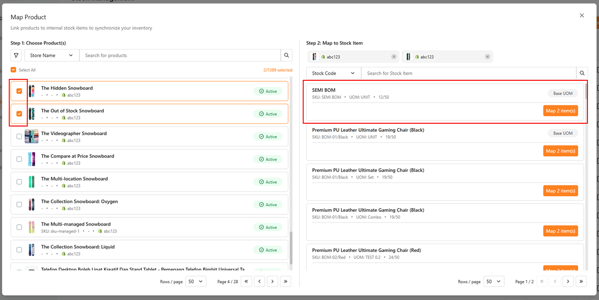

   :::info
   Use the **Filter Button** to narrow your **Platform Products** view, or use the **Search Bar** to find specific e-commerce products and stock items.
   :::

### Map Single Stock Item

1. Go to **Inventory > Stocks**

2. Click the icon to view stock details

   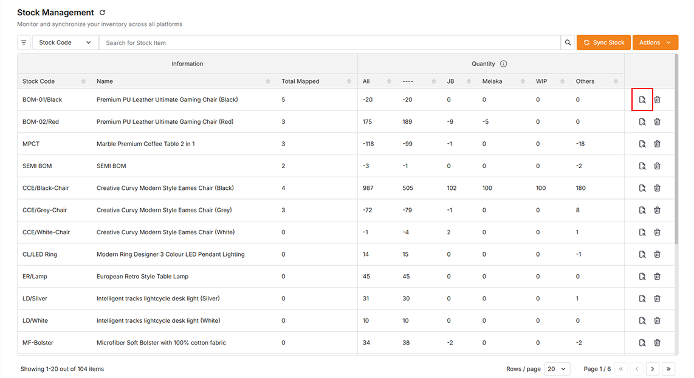

3. Click the **Map Product** button

   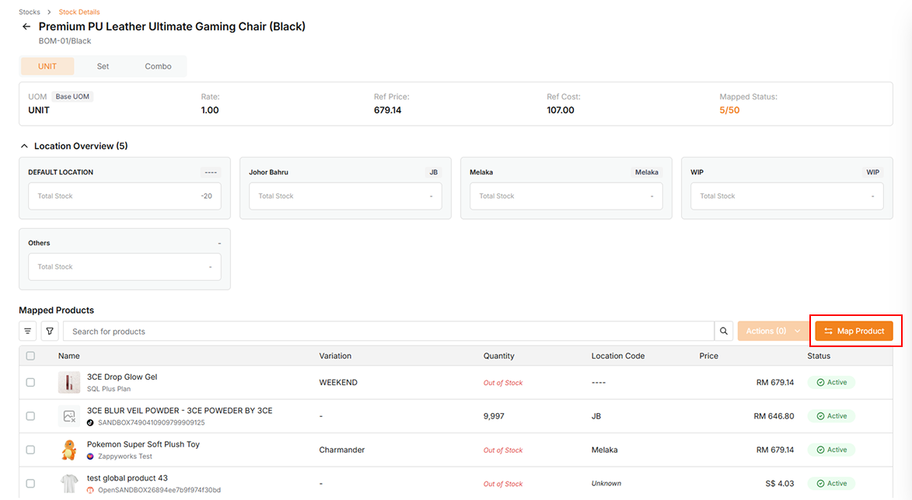

4. Select the **Platform Products** and click **Map Product** to map them directly to this **Stock Item UOM**

   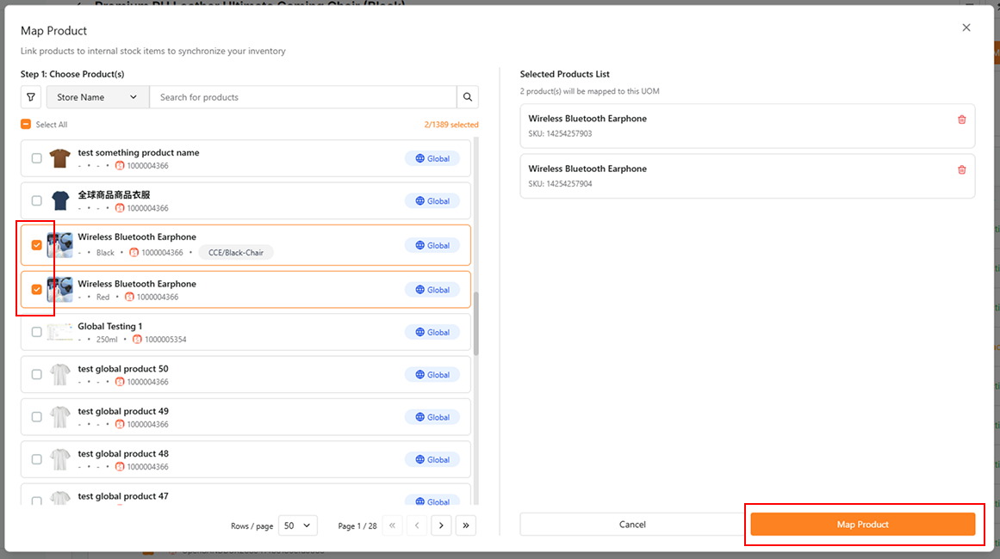

   :::info
   Ensure your store is mapped to the correct stock item location, or mapped items will fall under **Unknown Location**.
   To map the location code, please refer to **[Setup](../setup.md#step-4-code-mapping)**
   :::

### Automap Stock Item

1. Go to **Inventory > Stocks**

2. Click the **Auto Mapping** under the **Actions** button

   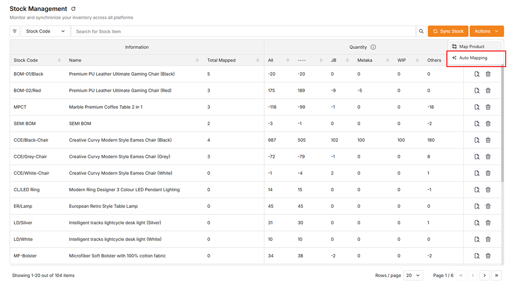

3. A dialog will open and there are two tabs available:

   - **Unmapped Products**: Display products that do not currently have a stock code mapping.

   - **Mapped Products**: Display products that already have a mapped stock code.

   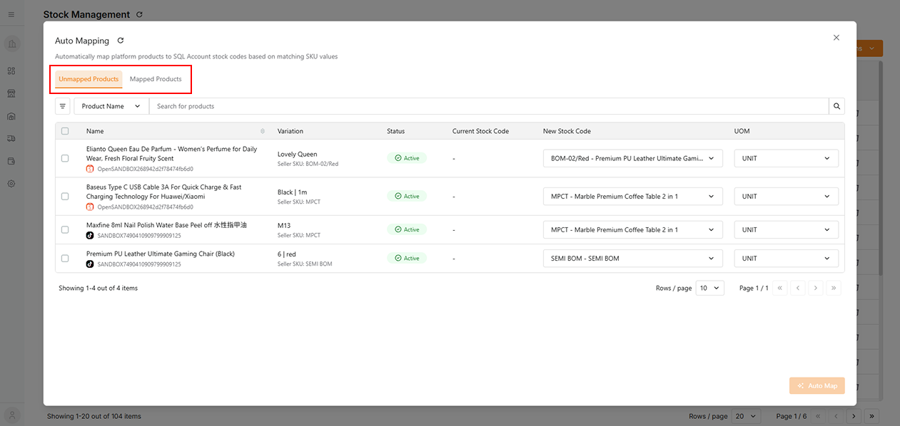

   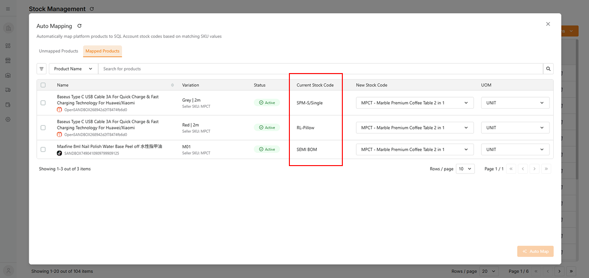

4. Both tabs display the products together with their suggested Stock Code and UOM. Users can make changes if necessary by:

   - Selecting a different Stock Code from the dropdown

      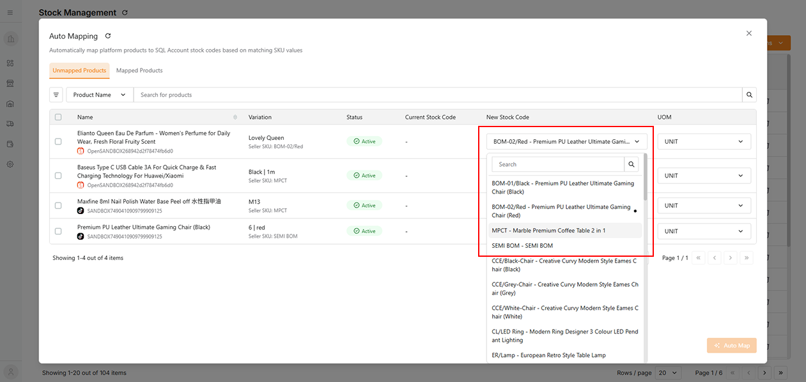

   - Selecting the appropriate UOM

      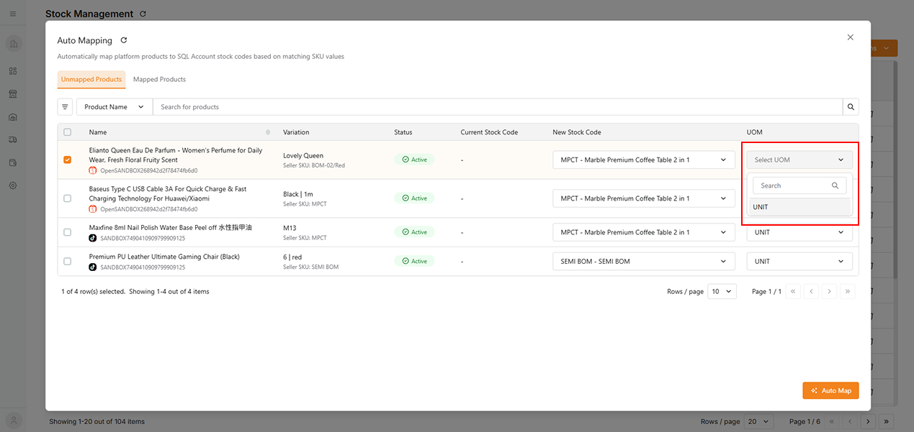

   :::info
      UOM must be selected for successful auto-mapping. Products without a selected UOM will be skipped during the mapping process.
   :::

5. Review and confirm that the Stock Code and UOM are correct, then select the products you want to map and click the **Auto Map** button.

   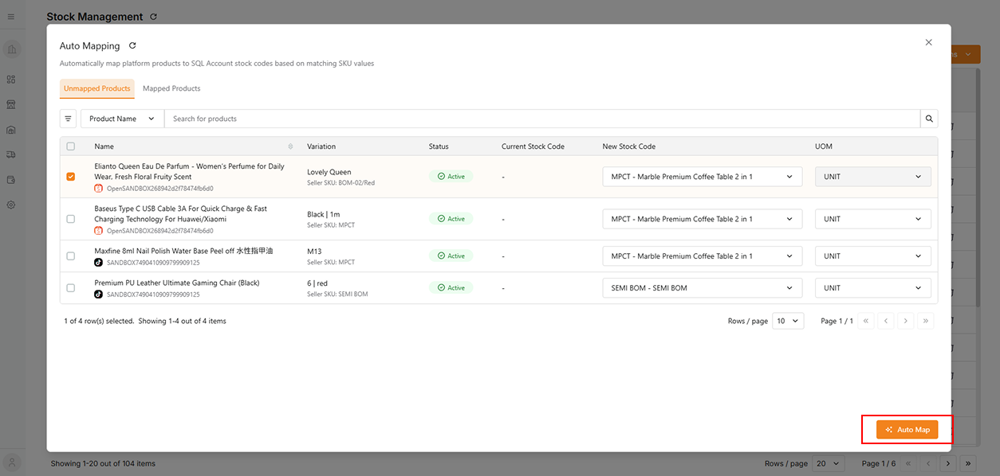

6. Click the Refresh icon to retrieve the latest product data and update the displayed information.

   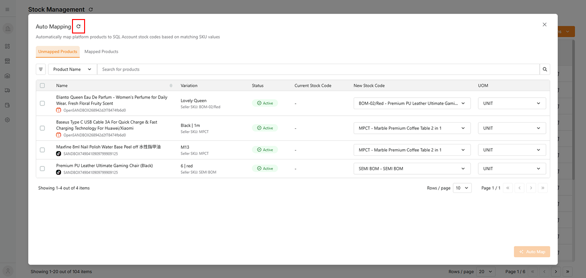

## Update Price & Quantity

1. Go to **Inventory > Stocks**

2. Click the icon to view stock details

   

3. Select the products you want to update by clicking the checkbox

4. Click the **Actions** button, then click **Update Price & Quantity**

   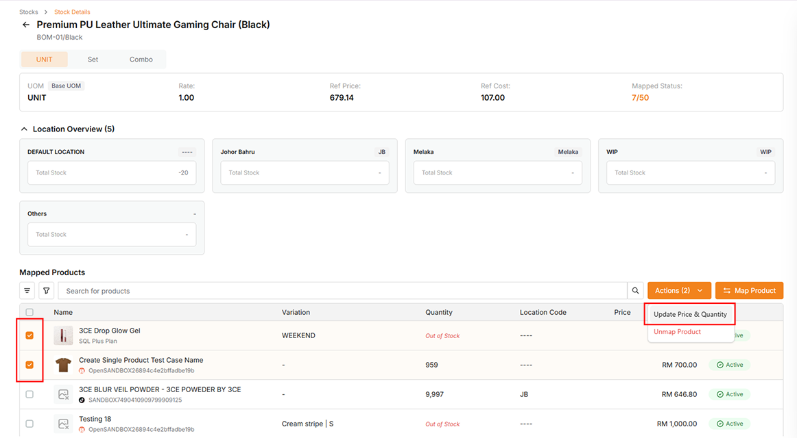

5. Choose an option for **Update Price** and **Update Quantity**. Both are set to **None** by default, and at least one must be changed to continue

   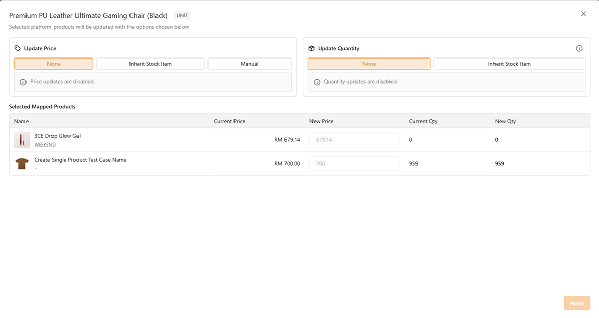

### Update Price

| Option                 | Description                                                                  |
| ---------------------- | ---------------------------------------------------------------------------- |
| **None**               | The price will not be updated                                                |
| **Inherit Stock Item** | All selected products are updated to the **Ref Price** of the selected UOM   |
| **Manual**             | Set a new price based on the **Ref Price**, or type a price for each product |

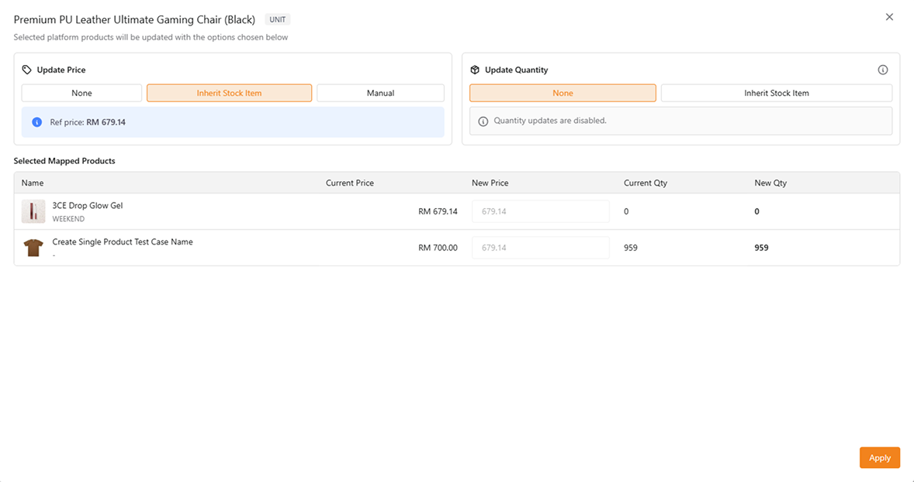

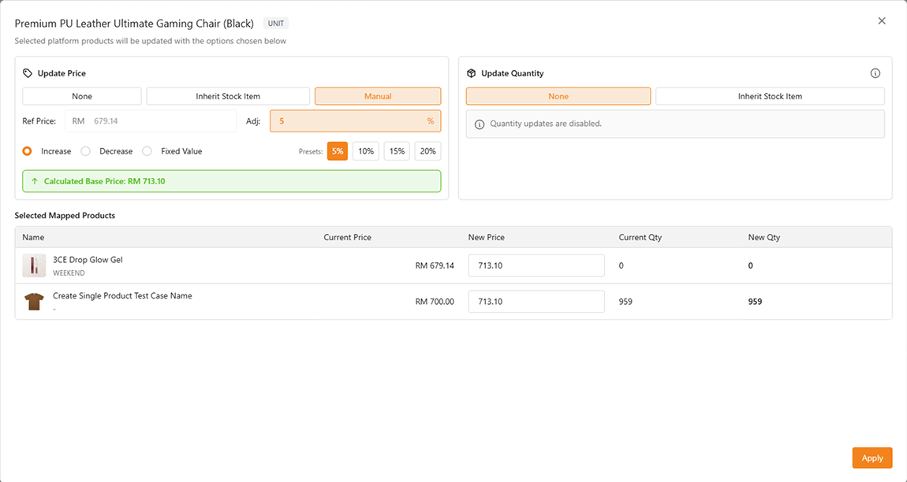

When **Manual** is selected, choose how the new price is set:

| Option          | Description                                           |  
| --------------- | ----------------------------------------------------- | 
| **Increase**    | Adds the **Adj** percentage to the **Ref Price**      | 
| **Decrease**    | Deducts the **Adj** percentage from the **Ref Price** | 
| **Fixed Value** | Uses the price typed in the **Ref Price** field       | 

### Update Quantity

| Option                 | Description                                                         |
| ---------------------- | ------------------------------------------------------------------- |
| **None**               | The quantity is not updated                                         |
| **Inherit Stock Item** | Products are updated to the stock quantity of their mapped location |

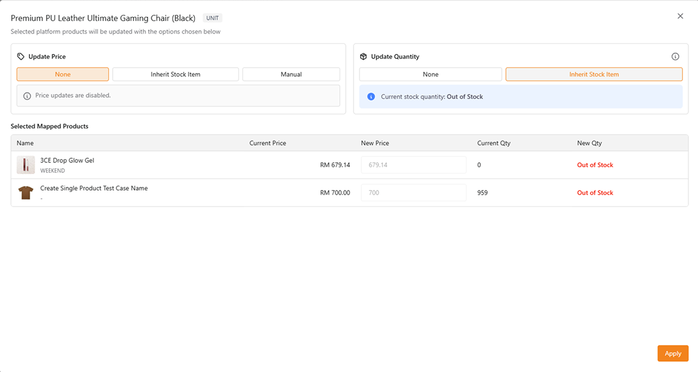

:::info
Products with an **unknown location** or **untracked quantity** will not be updated. 
:::

### Update Results

1. Click **Apply** to update the selected products

   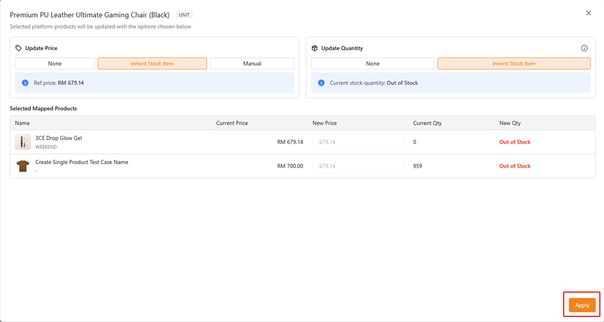

2. The **Update Results** dialog will appear, showing how many products were updated, failed or skipped, along with the reason for any failures

   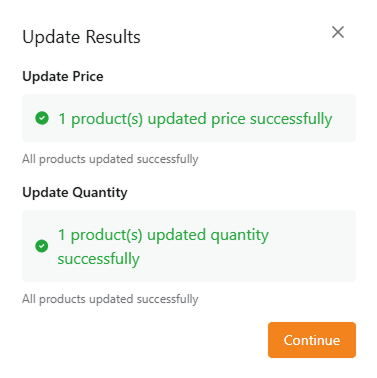

## Delete Stock

Users can delete a stock that is no longer required.

:::important
Before deleting a stock, make sure that there are **no product mappings** under the stock.
:::

1. Go to **Inventory > Stocks**

2. Click the icon to delete.

   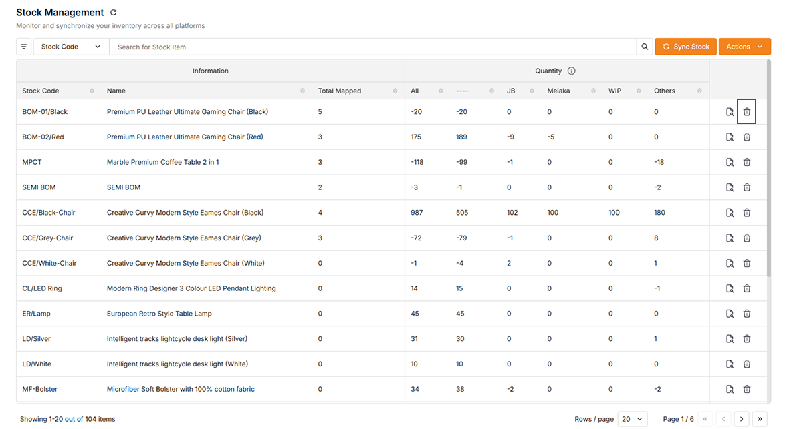

3. A confirmation dialog will appear. Click **Continue**.

   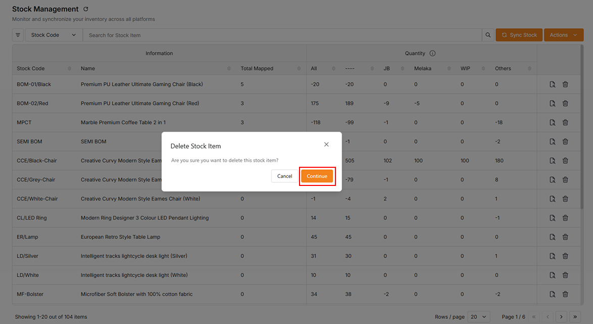

:::note
Once the stock is deleted, all information associated with the stock will also be permanently deleted, including **Item UOM, Item BOM, Alternative Code, Barcode and Location Code**. Please make sure the stock and all its related information are no longer required before confirming the deletion.
:::