## Overview

The **Order** module allows you to view, process, and manage orders from all your connected e-commerce platforms (Lazada, Shopee, TikTok, etc.) in one centralized location.

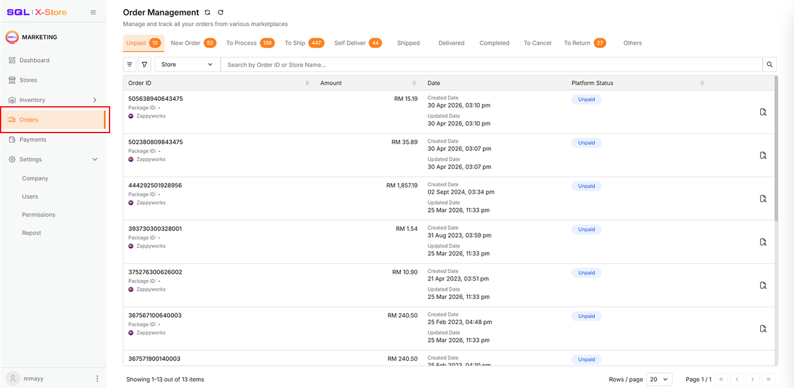

To access this page, navigate to **Orders** in the sidebar menu.

The Order Management interface is organized into tabs representing each stage of the order lifecycle. You can:

- Filter orders by date range
- Search by Order ID or Store Name
- Perform bulk actions (packing, shipping, printing)
- Track order status across all platforms

## Order Statuses

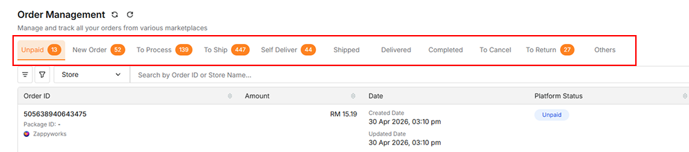

Orders are categorized into the following status tabs:

| Status         | Description                                                   |
| -------------- | ------------------------------------------------------------- |
| **Unpaid**     | Orders placed but not yet paid by the customer                |
| **New Order**  | Paid orders ready to be processed                             |
| **To Process** | Packed orders waiting to be shipped                           |
| **To Ship**    | Orders ready for courier handover                             |
| **Shipped**    | Orders currently in transit                                   |
| **Delivered**  | Orders successfully delivered to the customer                 |
| **Completed**  | Orders finalized and closed                                   |
| **To Cancel**  | Buyer-initiated cancellation requests pending seller approval |
| **To Return**  | Buyer-initiated return requests pending seller approval       |
| **Others**     | Orders with special or exceptional statuses                   |

## Order Processing Workflow

The order processing flow moves through several stages. Different actions are available at each stage.

### Step 1: Pack New Orders

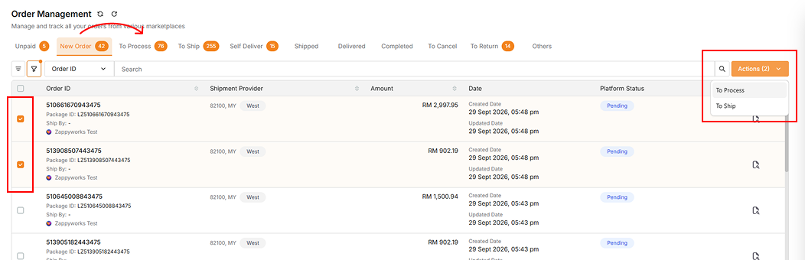

1. Select orders by clicking the checkbox next to each order
2. Click the **Pack** button
3. Packed orders will move to the **To Process** tab

### Step 2: Process Orders for Shipping

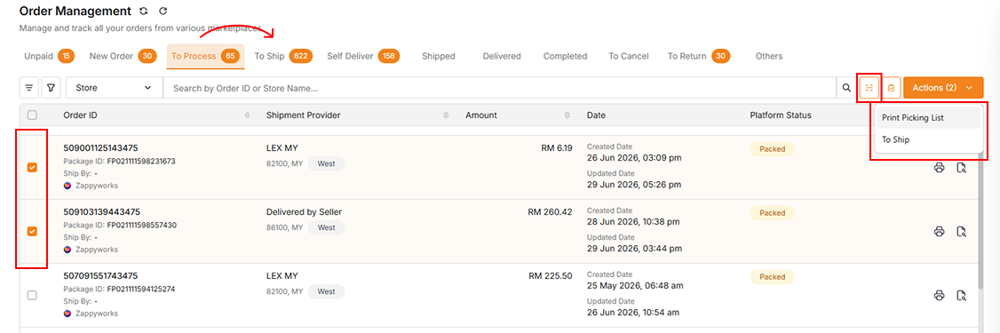

1. Select orders by clicking the checkbox next to each order
2. Click the **To Ship** button
3. Orders will move to the **To Ship** tab
4. (Optional) Use **Stock Pick** feature to verify order items before shipping
5. (Optional) Click the **Scan** icon to use the **Scan To Ship** feature for faster processing

#### Print Picking Document

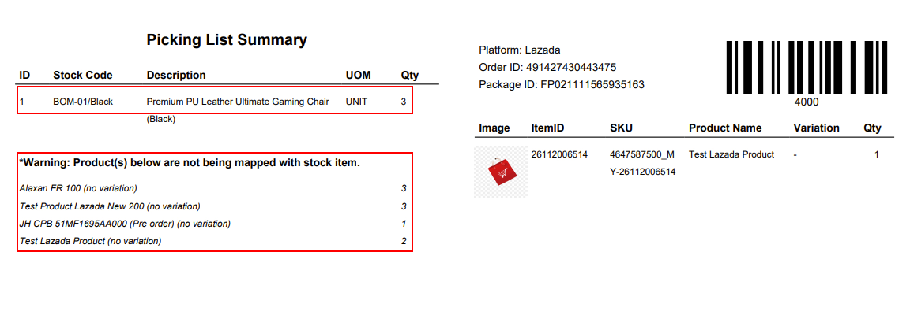

1. Click the **Print Picking List** button to generate the following:
   - **Picking List Summary:** A consolidated list of all order items for batch picking
   - **Picking List:** Individual picking lists generated per order, including barcodes 
2. The printed picking list can be used together with the **Scan To Ship** feature to speed up order fulfillment

### Step 3: Stock Pick (Optional)

Use **Stock Pick** to optionally verify package items before processing packages for shipping.

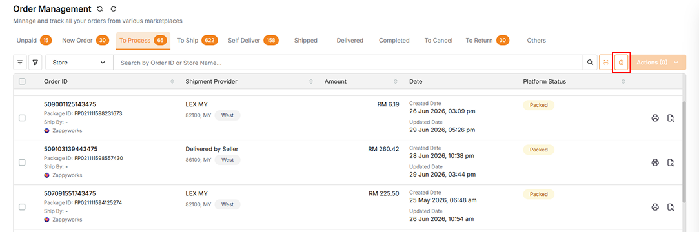

1. In the **To Process** tab, click the **Stock Pick** icon

#### Load an Order or Package

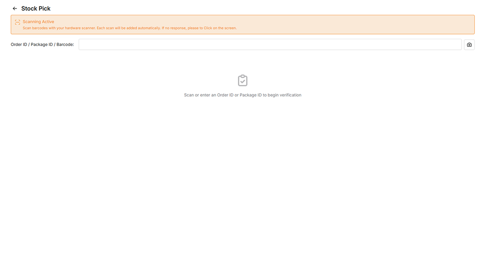

1. Click on the screen and scan the **Order ID**/**Package ID** 
2. **Alternative:** Type the **Order ID**/**Package ID** manually and press Enter
3. **Alternative:** Click the **Camera** icon to scan it with your device camera (see [Scan with Camera](#scan-with-camera))

What is loaded depends on what you scan:

| Scanned                                     | Result                                       |
| ------------------------------------------- | -------------------------------------------- |
| **Package ID**                              | That package is loaded for verification      |
| **Order ID** with one package to verify     | The package is loaded for verification       |
| **Order ID** with multiple packages         | The **Select Package** popup appears         |

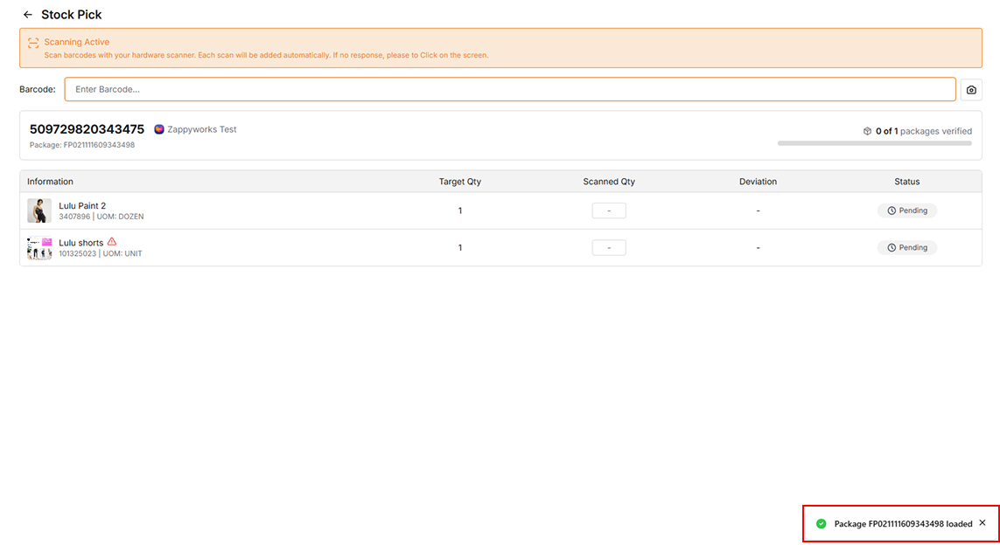

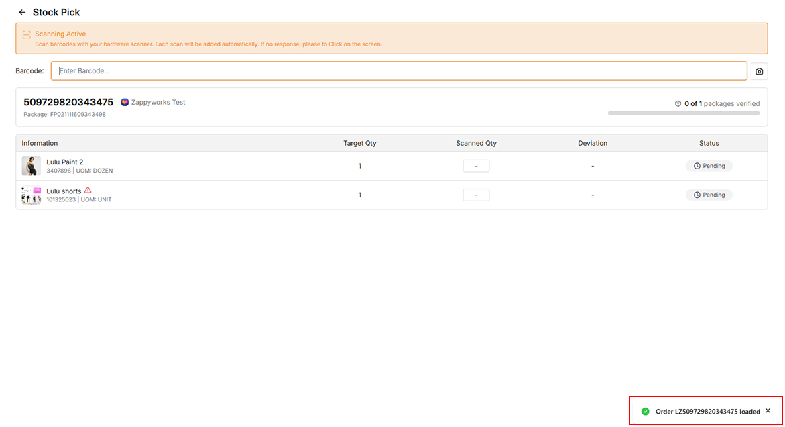

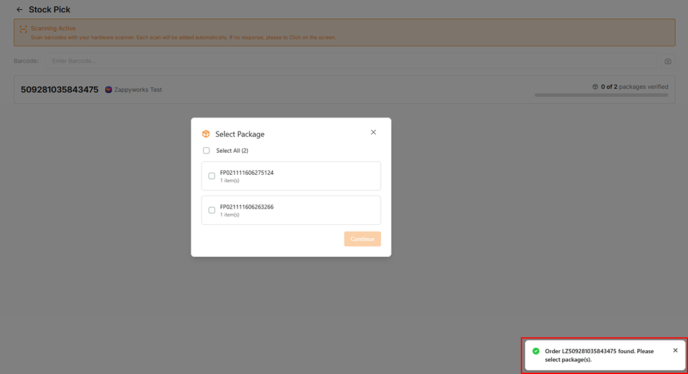

#### Select Packages

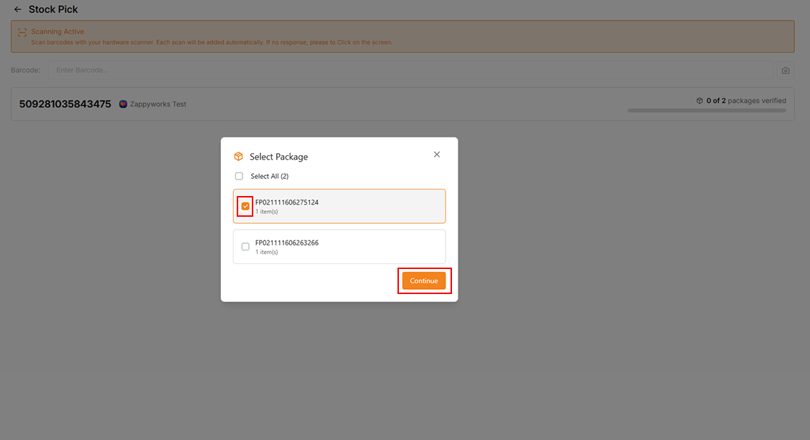

When the order has more than one package to verify:

1. Select the packages you want to verify by clicking the checkbox next to each package, or click the Select All checkbox to select every package within the order
2. Click **Continue**

#### Verify Items

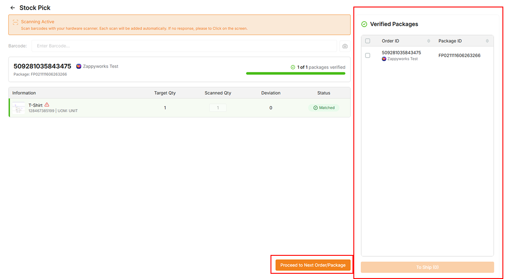

1. Click on the screen and scan the item barcode
2. **Alternative:** Type the barcode number manually and press Enter
3. **Alternative:** Click the **Camera** icon to scan the barcode with your device camera (see [Scan with Camera](#scan-with-camera))
4. **Alternative:** Type the quantity in the **Scanned Qty** field

Each item may show one of the following statuses:

| Status         | Description                                           |
| -------------- | ----------------------------------------------------- |
| **Pending**    | The item has not been scanned yet                     |
| **Matched**    | The scanned quantity matches the target quantity      |
| **Incomplete** | The scanned quantity is less than the target quantity |
| **Overscan**   | The scanned quantity is more than the target quantity |

If the scanned quantity does not match the target quantity (status showing **Incomplete** or **Overscan**), but you have manually confirmed the package is correct:

1. Click the **Complete Verification** button to mark the package as verified
2. The package is added to the **Verified Packages** list, and the next selected package is loaded (If you selected more than one package)

When all packages are verified, a success popup appears:

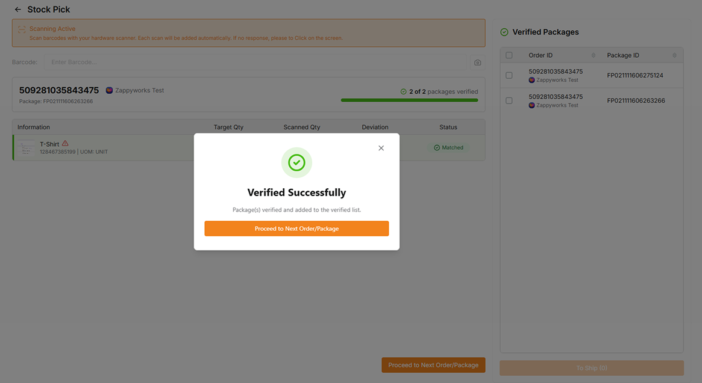

1. Click **Proceed to Next Order/Package** to clear the screen and scan the next order or package
2. **Alternative:** Close the popup to review the current package, then click **Proceed to Next Order/Package** at the bottom of the screen when you are done

#### Move Verified Packages to To Ship

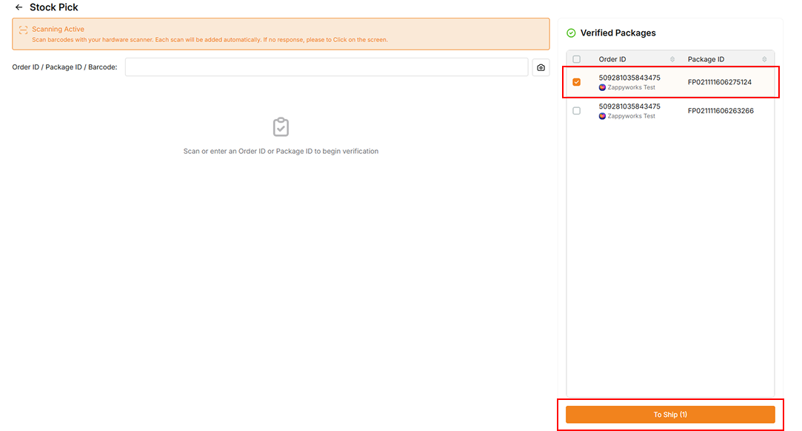

1. Select the packages you want to ship by clicking the checkbox next to each package, or click the header checkbox to select all
2. Click the **To Ship** button

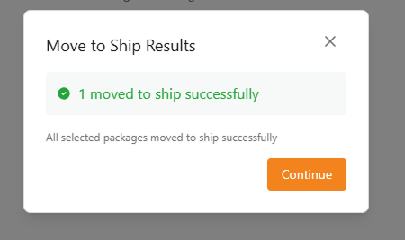

#### Scan with Camera

If you do not have a hardware scanner, you can use your device camera to scan the Order ID and item barcodes.

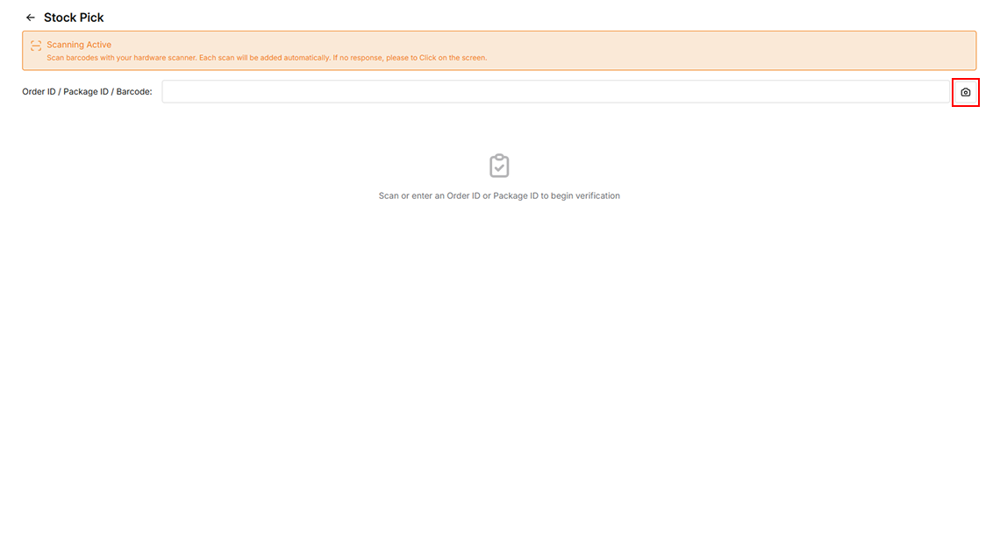

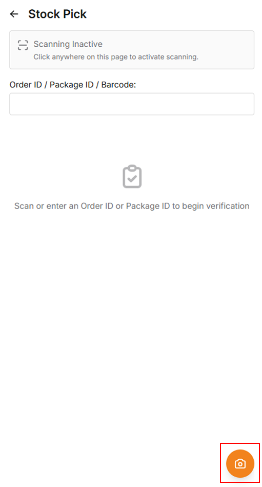

1. Click the **Camera** icon
2. Allow camera access when your browser asks for permission

   :::info
   If you blocked the camera before, allow it in your browser's site settings, then click the **Camera** icon again.
   :::

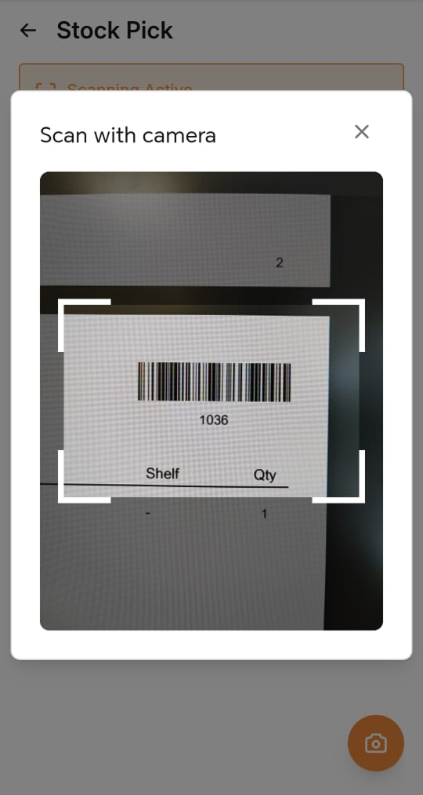

3. Point the camera at the barcode and keep it inside the scanning box

   :::info
   The camera reads one barcode each time it is opened.
   :::

### Step 4: Scan To Ship (Optional)

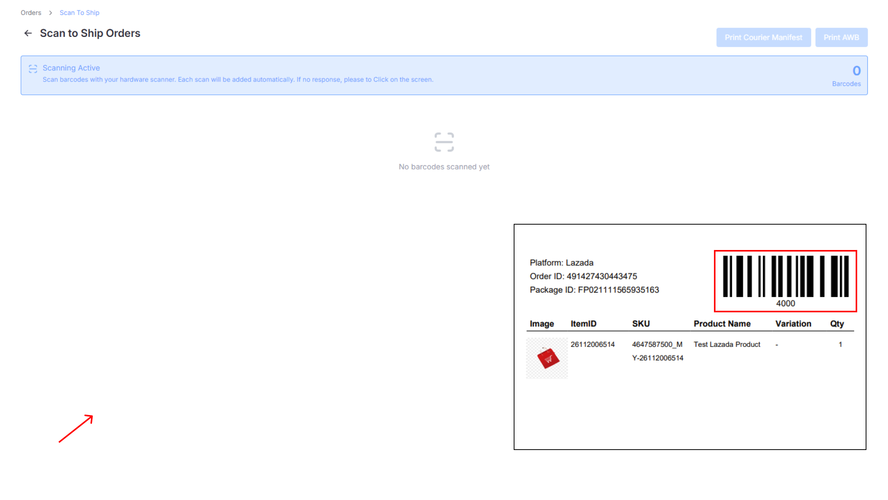

1. Click on the screen and scan the barcode from the picking list
2. **Alternative:** Type the barcode number manually and press Enter

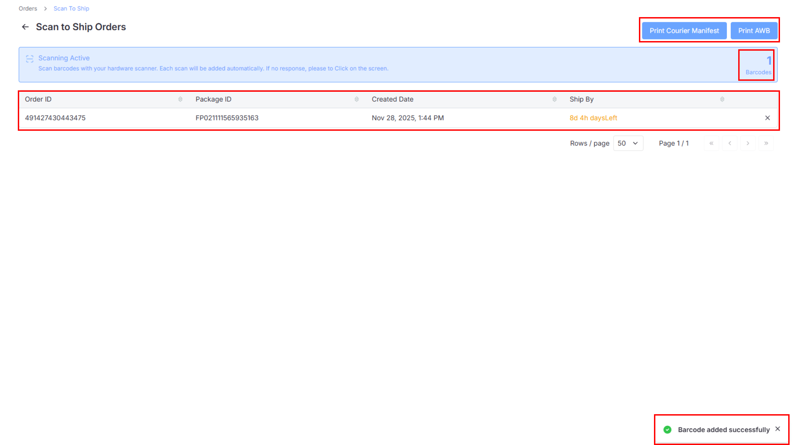

| Action                     | Description                            |
| -------------------------- | -------------------------------------- |
| **Print AWB**              | Print Air Waybills for selected orders |
| **Print Courier Manifest** | Generate a manifest for courier pickup |

### Step 5: To Ship

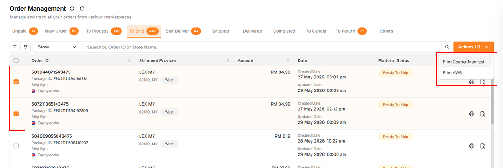

| Action                     | Description                            |
| -------------------------- | -------------------------------------- |
| **Print AWB**              | Print Air Waybills for selected orders |
| **Print Courier Manifest** | Generate a manifest for courier pickup |

### Step 6: Self Deliver

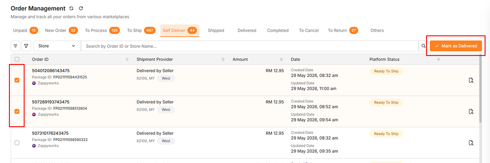

| Action                     | Description                            |
| -------------------------- | -------------------------------------- |
| **Mark as Delivered**      | Mark the order as delivered            |

## General Features

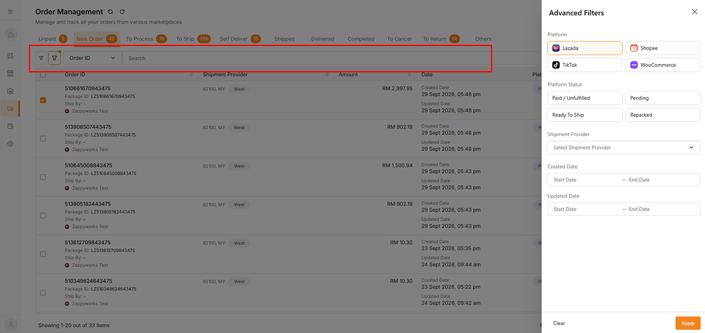

| Feature                         | Description                                                                                             |
|---------------------------------|---------------------------------------------------------------------------------------------------------|
| **Search**                      | Find orders by **Order ID**, **Store Name**, **Package ID** or **Tracking Number** using the search bar |
| **Column Visibility**           | Click the leftmost button to show/hide specific table columns                                           |
| **Filter by Platform**          | Displays orders based on platform filtered                                                              |
| **Filter by Platform Status**   | Displays orders based on platform status filtered                                                       |
| **Filter by Shipment Provider** | Displays orders based on shipment provider filtered                                                     |
| **Date Range**                  | Filter orders by created or updated date using the date picker                                          |
