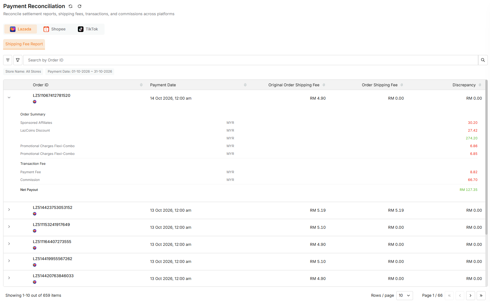
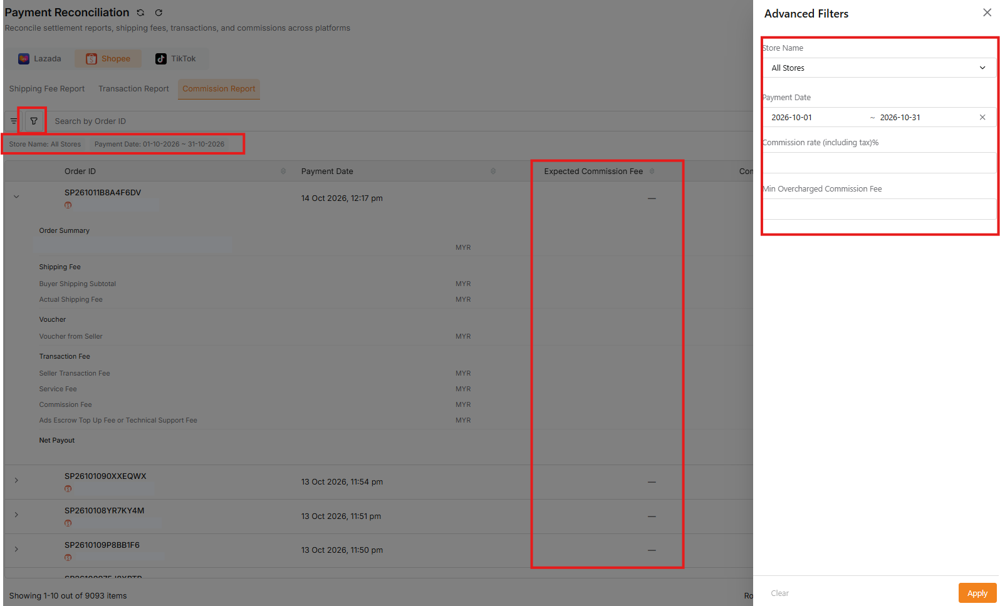
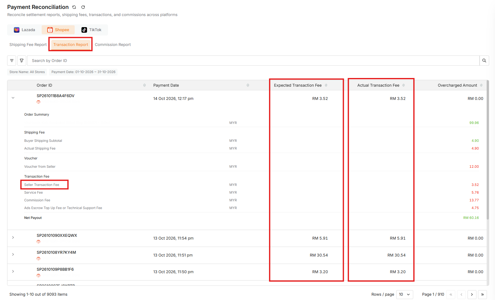
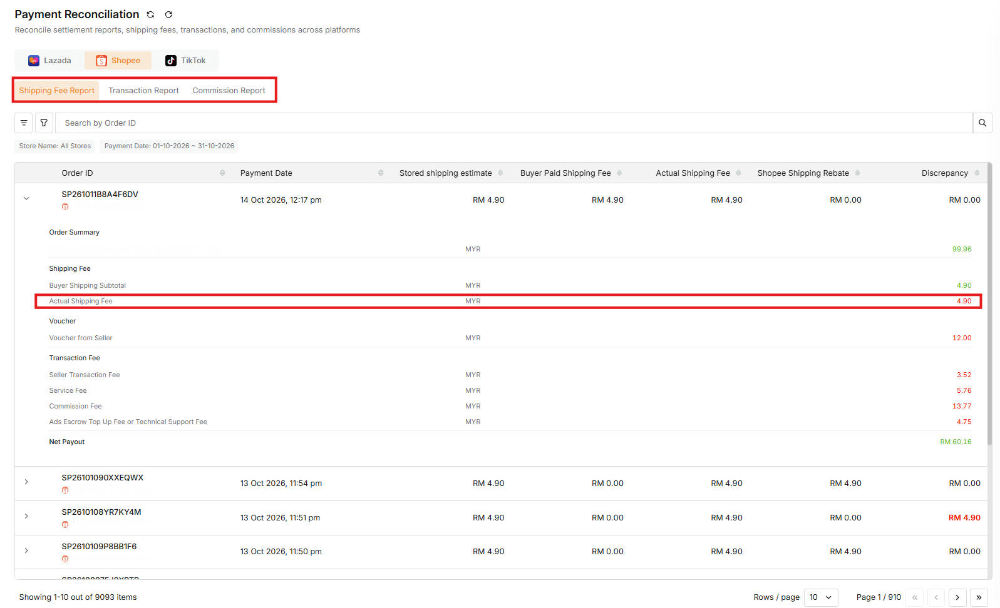

Payment reconciliation means comparing recorded transactions with platform payout records to identify differences.

## Reports by Platform

The reports available in payment reconciliation depend on the platform.

| Platform | Available reports |
| --- | --- |
| Lazada | Shipping Fee Report only |
| Shopee | Shipping Fee Report, Transaction Report, and Commission Report |
| TikTok | Shipping Fee Report, Transaction Report, and Commission Report |

## Commission Report

Use the **Commission Report** to compare the commission charged by the platform with the expected commission for each order.

Click the **filter icon** next to **Search** to open **Advanced Filters**.

| Filter | How to use it |
| --- | --- |
| **Store Name** | Choose a specific store or keep **All Stores**. |
| **Payment Date** | Select the payment date range to review. The default range covers one month. |
| **Commission rate (including tax)%** | Enter the platform's commission rate, including tax, as a percentage. The report uses this rate to calculate the **Expected Commission Fee** for each order. |
| **Min Overcharged Commission Fee** | Enter the minimum overcharge amount you want to ignore. |

Click **Apply** to update the report. When the commission rate is blank, the **Expected Commission Fee** column displays a dash.

:::note

Advanced Filters are also available in other reports.

:::

## Transaction Report

Use the **Transaction Report** to compare the transaction fee charged by the platform with the expected transaction fee for each order.

| Platform | The percentage platform charged |
| --- | --- |
| **Shopee** | calculated as **3.78%** (after SST) of the final order amount paid by the buyer (inclusive of shipping fee), rounded up to 2 decimal places. https://seller.shopee.com.my/edu/article/3503 |
| **Tiktok** | via TikTok PayLater: **4.86%** (SST inclusive), For other payment methods: **3.78%** (SST inclusive), https://seller-my.tiktok.com/university/essay?knowledge_id=7753792938985218 |

## Shipping Fee Report

Use the **Shipping Fee Report** to compare the shipping fee charged by the platform.

The Overcharged amount will be shown in **Red** within the discrepancy column.

