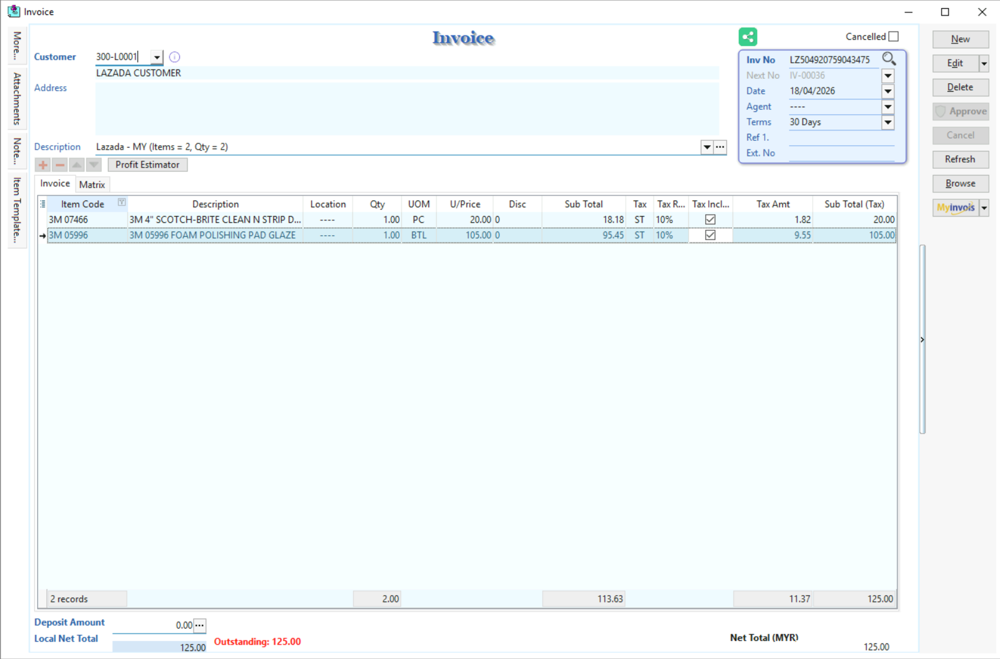
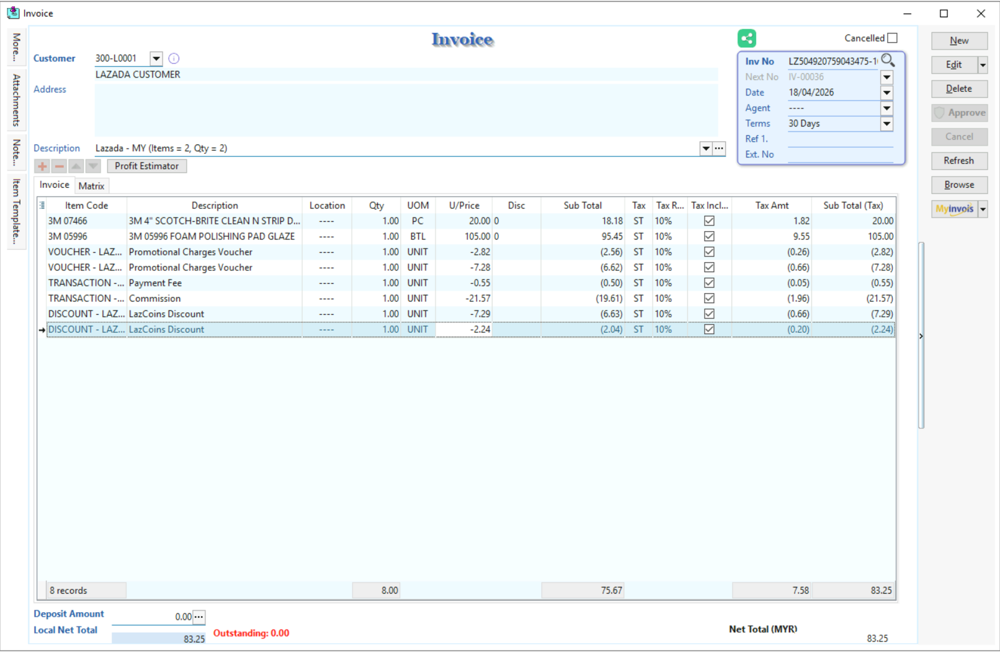
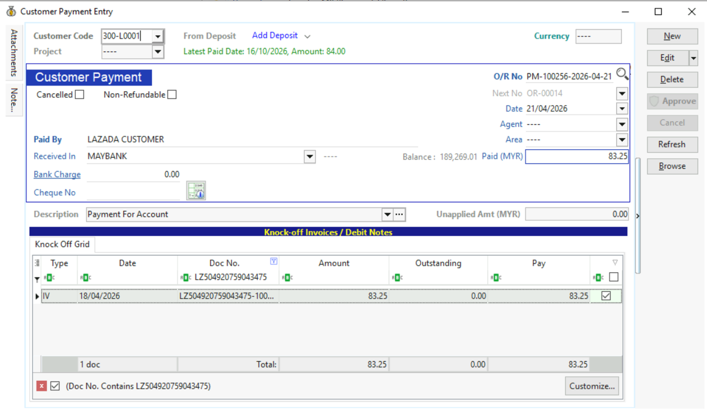
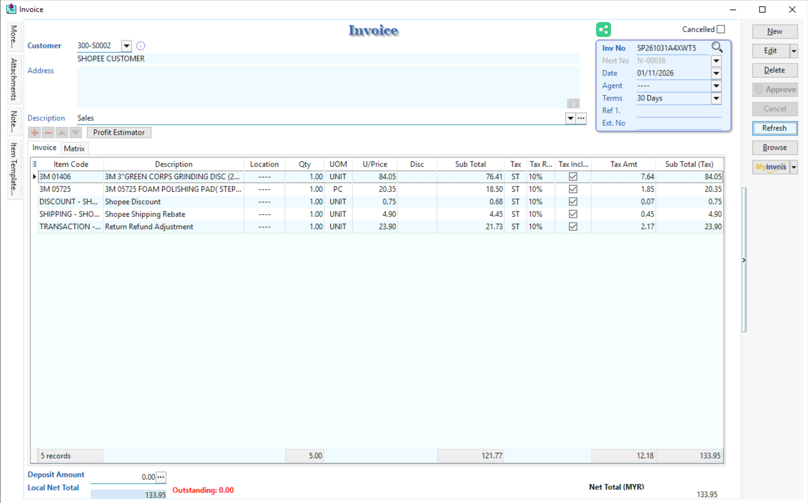
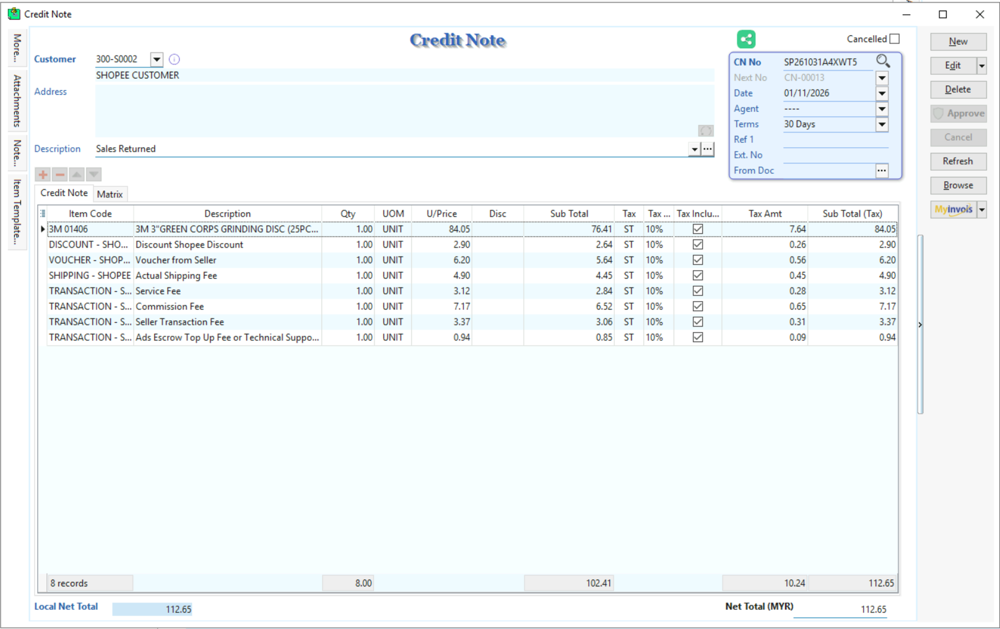
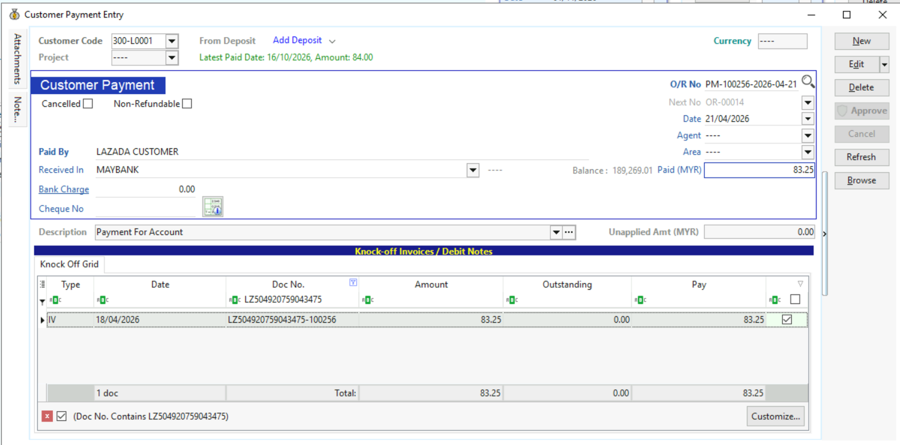
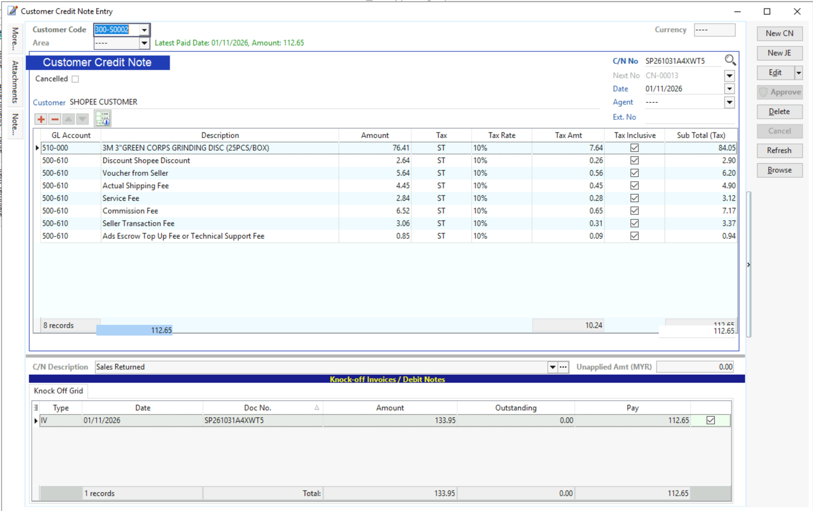
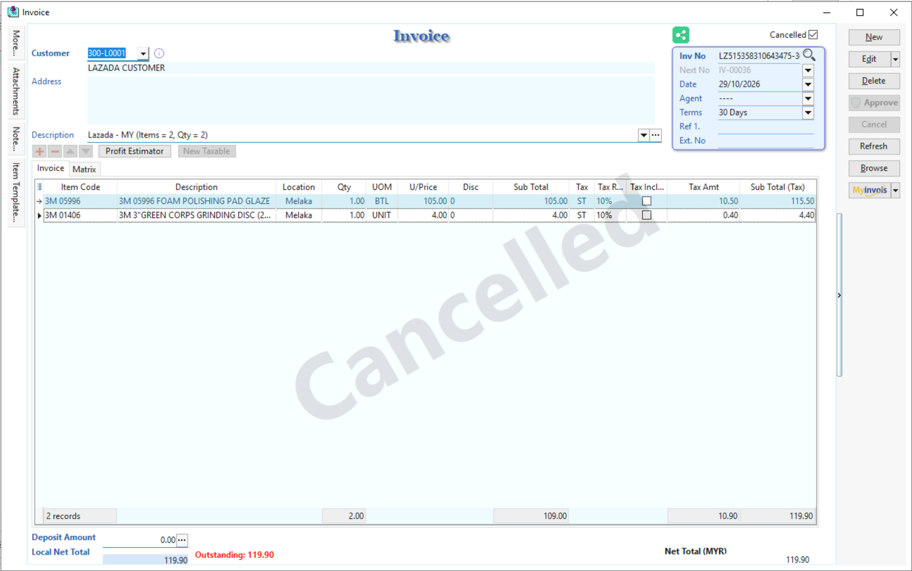
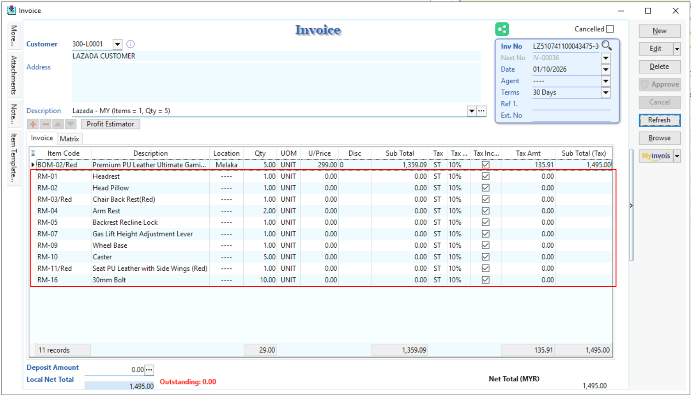

When you post an order from X-Store to SQL Account, different accounting documents may be created depending on the order's settlement status, and other conditions.

This guide explains what happens in each scenario and shows examples of the documents created.

## Case 1: Posting an Order Before Settlement

**Scenario:** The order has been shipped, but payment from the e-commerce platform has not yet been settled.

**What happens?**

- An **Invoice (IV)** and **Customer Invoice** are created.
- The invoice will have an **outstanding balance** because payment has not yet been received.
- The **invoice date** will follow the order's **shipped date** provided by the e-commerce platform.
- If the shipped date is unavailable, the order **creation date** will be used instead.

#### Invoice

## Case 2: Posting an Order After Settlement

**Scenario:** The e-commerce platform has already settled the payment for the order.

**What happens?**

- An **Invoice (IV)** and **Customer Invoice** are created or updated.
- A **Payment (PM)** document is created to record the received payment.
- The payment **knockoff** with the IV outstanding balance.
- The **payment date** follows the **settlement date** provided by the e-commerce platform.

#### Invoice

#### Payment

## Case 3: Posting a Return & Refund Order

**Scenario:** A customer has returned one or more items and received a refund.

**What happens?**

- A **Credit Note (CN)** is created to record the returned or refunded items.
- The Credit Note is applied against the original Invoice (IV).
- Depending on the remaining amount after deducting the Credit Note, a **Payment (PM)** or **Customer Refund (CF)** may be created.

The following table explains the possible outcomes:

| Condition                           | Result                 |
| ----------------------------------- | ---------------------- |
| **Invoice Amount > Credit Note Amount** | A **Payment (PM)** is created for the remaining amount after applying the Credit Note.   |
| **Invoice Amount < Credit Note Amount** | A **Customer Refund (CF)** is created for the difference after applying the Credit Note. |
| **Invoice Amount = Credit Note Amount** | The Credit Note fully offsets the Invoice. No Payment or Customer Refund is created. |

#### Invoice

#### Credit Note

#### Payment

#### Customer CN knockoff with IV

## Case 4: Posting a Cancelled Order

**Scenario:** The order has been cancelled on the e-commerce platform.

**What happens?**

- A **cancelled Invoice (IV)** is created.
- The cancelled invoice retains the items originally included in the order for reference.

#### Invoice

## Case 5: Posting an Order With BOM Items

**Scenario:** An order's product is mapped to a **non-stock-control item** in SQL Account that contains **BOM components**.

**What happens?**

- X-Store identifies the BOM components associated with the mapped stock item.
- When the order is posted, the **BOM components are included in the Invoice (IV)**.
- The invoice displays the component items along with the mapped product.

#### Invoice
