The User Profile page displays your account information.

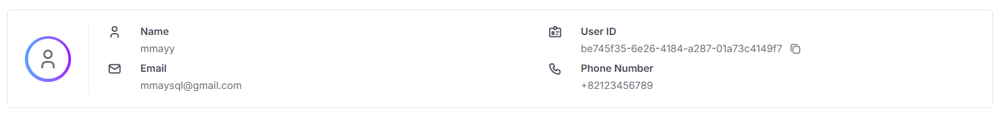

| Field            | Description                        |
|------------------|------------------------------------|
| **Name**         | Your display name                  |
| **Email**        | Your registered email address      |
| **User ID**      | Unique identifier for your account |
| **Phone Number** | Contact phone number               |

## Update User Profile

1. Click the **Edit Profile** button.

   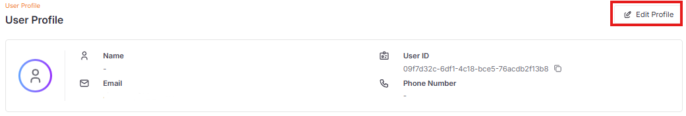

2. Update the fields and click **Save**.

   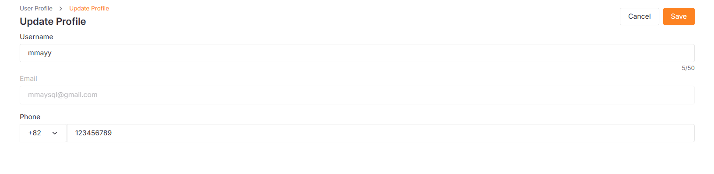

## Passkeys

Manage your registered passkeys for secure authentication.

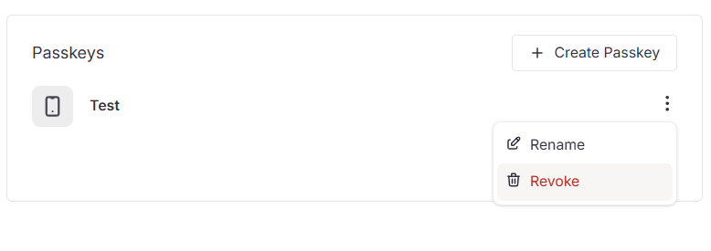

### Register New Passkey

1. Click **Create Passkey** button.

   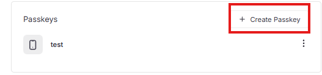

2. Enter a **Passkey Name** to help you identify this device later.

   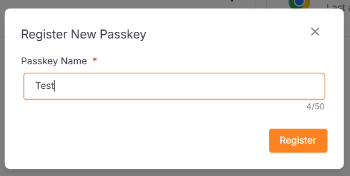

3. Click **Register**, then complete the authentication prompt on your device.

   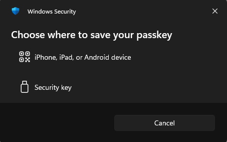

### Rename Passkey

1. Click the **More** icon and select **Rename**.

2. Rename your passkey and click **Save**.

   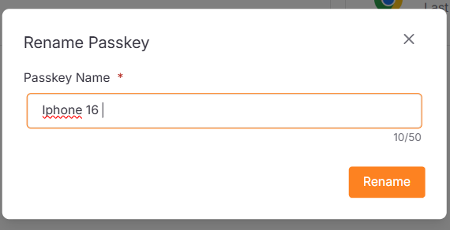

### Revoke Passkey

1. Click the **More** icon and select **Revoke** to remove the passkey immediately.

## Sessions

View your active login sessions across different devices and browsers.

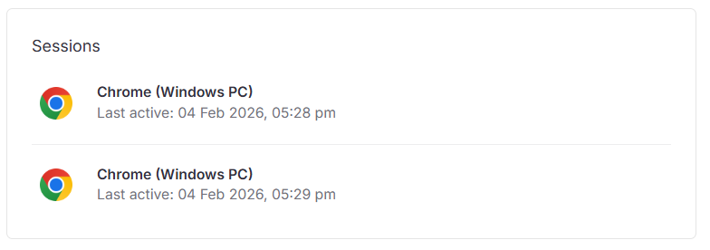

### Logout Sessions

1. Click on the session.

   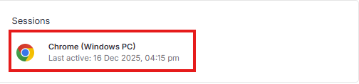

2. Click **Confirm** to revoke.

   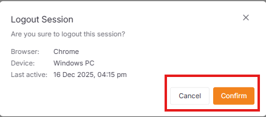
